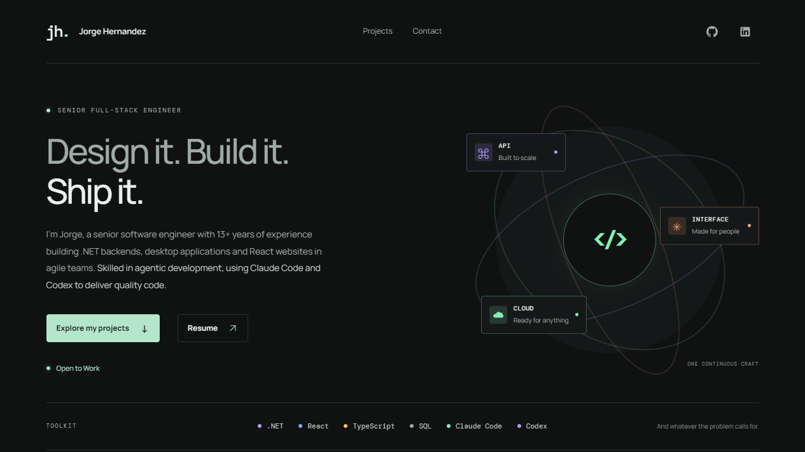

# Jorge Hernandez's portfolio

Personal portfolio showcasing Jorge Hernandez's software projects, resume, and contact information.

[](https://jorgeahernandez.com)

## Local development

Requires Node.js 22 or newer and npm. An `.nvmrc` is included for version managers.

```sh
npm ci
npx http-server@14.1.1 site -a 127.0.0.1 -p 8000 -c-1
```

Open [127.0.0.1:8000](http://127.0.0.1:8000). The server serves `site/` with caching disabled; refresh the browser after edits.

## Build and deploy

```sh
npm run build
```

Publish `dist/`. Each build replaces its contents; edit `site/` instead.

Set `EMAIL_USER` and `EMAIL_DOMAIN` in your shell or hosting build settings to configure the contact address. If either is missing or blank, the build uses `hello@example.com`. `.env` files are not loaded. Rebuild after changes and preview with `npx http-server@14.1.1 dist -a 127.0.0.1 -p 8000 -c-1`; serving `site/` always uses the default address. Stop the development server before previewing, since both use port 8000.

Cloudflare configuration lives in `wrangler.jsonc`. For domain changes, also update `site/sitemap.xml` and `site/robots.txt`.

## Formatting

Run `npm run format -- <files>` on changed files, or `npm run format:check -- <files>` to check without writing. Both use the repository's pinned Prettier and configuration.

## License

[MIT](LICENSE).
